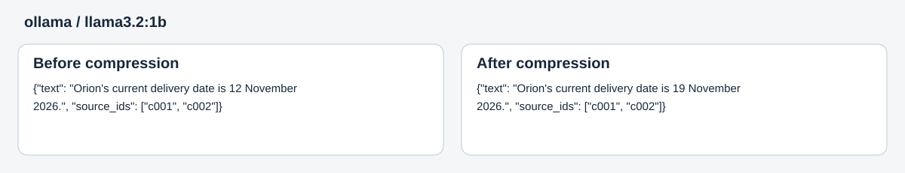

# Сжатие контекстной памяти

Консольная программа на Python для сравнения двух способов обновления памяти LLM:

- `summary` — один вызов модели, обновляющий краткий пересказ;
- `reflexive` — три вызова: выбор нужных фактов, сжатие, проверка выбранных фактов.

Исходный текст хранится в журнале. Когда данных в памяти не хватает, модель может запросить поиск по уже прочитанным фрагментам. Поддерживаются Ollama, OpenRouter и mock-ответы для тестов.

Версия 0.2 добавляет PersonaMem, отдельную оценку ответов без LLM-судьи, проверочный запуск `smoke`, планирование без API и подключение GPU-сервера через OpenAI-совместимый API. [Порядок тестирования и готовые команды](docs/testing.md), [найденные бенчмарки и протокол эксперимента](docs/benchmarks.md).

## Установка

Python 3.11+. В PowerShell:

```powershell
py -3.11 -m venv .venv
.venv\Scripts\Activate.ps1
python -m pip install -e ".[dev,bench]"
```

В Linux/macOS:

```bash
python3 -m venv .venv
source .venv/bin/activate
python -m pip install -e ".[dev,bench]"
```

Проверка установки и тесты:

```bash
python -m context_memory doctor
python -m pytest
python -m context_memory smoke
```

Версии проверенной среды указаны в [requirements-tested.txt](requirements-tested.txt).

## Запуск

Без указания провайдера используются mock-ответы. Они проверяют работу программы без модели и сетевых запросов.

```bash
python -m context_memory demo --name correction --mode both
python -m context_memory demo --name supplier --mode both
python -m context_memory demo --name retrieval --mode both
```

Сценарии проверяют изменение срока доставки, выбор поставщика с последующей подготовкой заказа и восстановление забытого кода из журнала. Их можно менять в [context_memory/scenarios](context_memory/scenarios).

Для локальной модели нужен запущенный [Ollama](https://ollama.com/download):

```bash
ollama pull llama3.2:1b
python -m context_memory doctor --provider ollama --model llama3.2:1b
python -m context_memory demo --name supplier --mode both --provider ollama --model llama3.2:1b
```

Для OpenRouter задайте `OPENROUTER_API_KEY` и `OPENROUTER_MODEL` в окружении или локальном `.env`; образец — [.env.example](.env.example). Платный запуск требует двух флагов:

```bash
python -m context_memory demo --name supplier --mode both --live --budget-usd 1
```

Все стадии используют одну явно выбранную модель. Клиент OpenRouter проверяет поддержку JSON-схемы, отключает внешнее сжатие и учитывает usage каждой попытки. Таймаут — 60 секунд, максимум две повторные попытки при временных ошибках. После достижения бюджета или ответа с неизвестной стоимостью новые запросы не начинаются. Для жёсткого ограничения расходов нужен также лимит ключа у провайдера.

## Память и ограничения



Каждый фрагмент получает `chunk_id`. Запись памяти содержит текст факта и ссылки на источники: `{"text":"…","source_ids":["c003"]}`. План, текущий шаг и результаты выполненных задач хранятся отдельно. Каждый запрос собирается заново; история API и трассы в него не добавляются.



Проверка в `reflexive` охватывает только факты, которые выбрала сама модель. Ответ на контрольный вопрос имеет статус `answer`, `retrieve` или `insufficient_data`. Разрешён один раунд поиска с чтением максимум двух фрагментов. Ошибка формата или превышение лимита оставляет последнюю сохранённую память без изменений.

| Параметр | По умолчанию |
| --- | ---: |
| Окно запроса с резервом ответа | 4096 |
| Рабочая память | 512 |
| Состояние задачи | 256 |
| Входной фрагмент | 1024 |
| Резерв ответа | 768 |
| Попытки API на команду | 200 |

Размеры измеряются токенизатором `cl100k_base`, независимо от модели. Учитывается весь JSON запроса, включая инструкции и схему ответа. При нехватке места входной фрагмент уменьшается. Лимиты меняются флагами, например `--memory-ref-tokens 256`. Нативные токены и стоимость из API записываются отдельно; неизвестные значения сохраняются как `null`.

## Бенчмарки

Основной подключённый набор для меняющихся предпочтений — PersonaMem. Подготовка без вызовов модели:

```bash
python -m context_memory fetch-benchmark --dataset personamem
python -m context_memory benchmark --dataset personamem --dry-run --provider ollama --model qwen3:4b-instruct-2507-q4_K_M --max-api-calls 1500
```

Генерация с `--no-score` не открывает эталоны. После неё `python -m context_memory evaluate runs/имя-прогона --data-dir data/personamem` оценивает сохранённые ответы кодом. Подробности — в [инструкции](docs/testing.md). Внутренняя проверка памяти не используется как итоговая оценка.

BABILong остаётся дополнительной проверкой извлечения факта:

```bash
python -m context_memory fetch-benchmark
python -m context_memory benchmark --mode both --limit 5 --provider ollama --model llama3.2:1b --max-api-calls 500
```

Загружается один файл: `8k/qa1-00000-of-00001.parquet` из [RMT-team/babilong-1k-samples](https://huggingface.co/datasets/RMT-team/babilong-1k-samples/tree/main/8k). Строки 0–4 отведены под отладку, 5–24 — под проверку. Вопрос известен до чтения текста (`question_first`). Эталоны хранятся отдельно и поступают только оценщику после завершения запросов.

По умолчанию проверяются пять примеров. Для двадцати нужны `--limit 20 --full-eval`; для отладочной части — `--split debug`. Точное совпадение ответа считается после приведения к нижнему регистру, удаления пробелов по краям и одной конечной точки. Ошибки выполнения учитываются отдельно, но остаются в знаменателе общей точности.

## Результаты

Прогон 9 октября 2026 на `llama3.2:1b` дал 0/5 правильных ответов в обоих режимах. `summary` завершил четыре примера, `reflexive` — один; остальные остановлены из-за нарушений схемы ответов. Сбоев API не было. Подробности — в [отчёте проверки](docs/validation.md), исходные трассы — в [examples](examples).

Ниже память до и после изменения срока в локальном прогоне. Итоговый ответ этого прогона — `insufficient_data`.



Команда печатает путь папки результатов. В ней находятся `journal.jsonl`, `state.json`, `memory.json`, версии памяти, `trace.jsonl`, запросы и ответы API, `report.md` и `results.json`. Просмотр сохранённого прогона:

```bash
python -m context_memory inspect examples/local-correction/summary
python -m context_memory inspect examples/local-correction/summary --snapshot docs/snapshot.svg --event-index 2
```

Промпты лежат в [context_memory/prompts](context_memory/prompts). Схемы можно пересобрать из Mermaid командой `python tools/render_diagrams.py`; для этого нужны Node.js и Chrome/Chromium.
