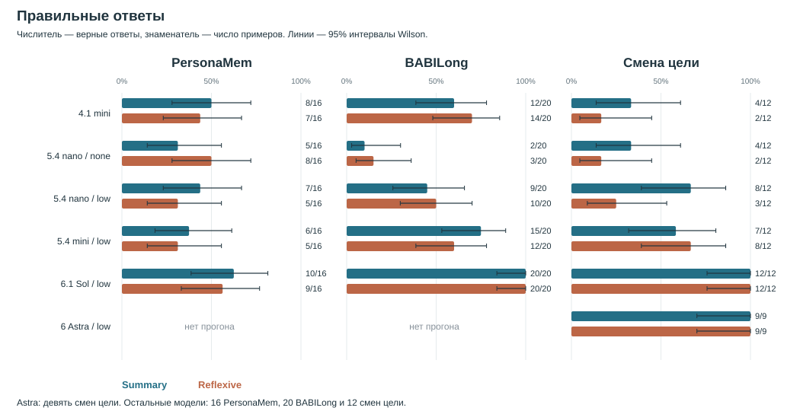
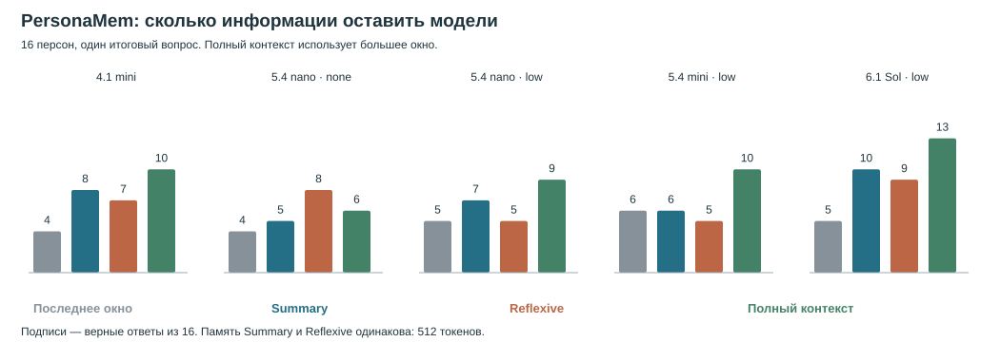
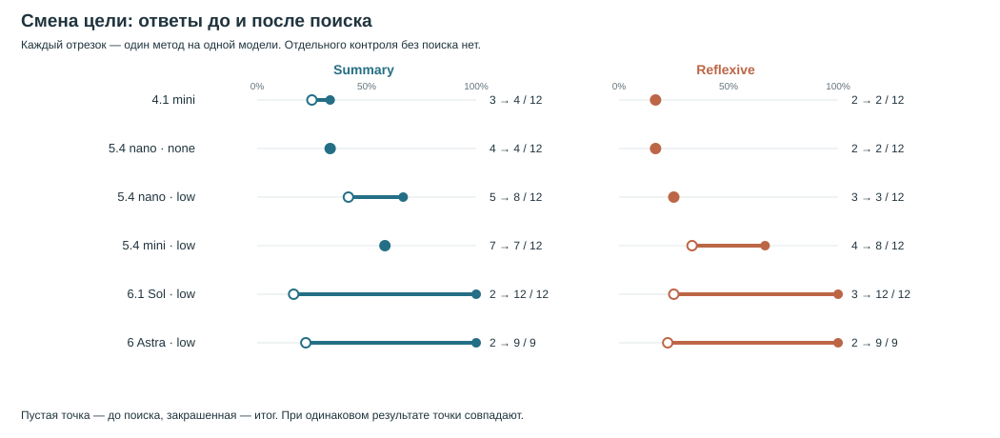
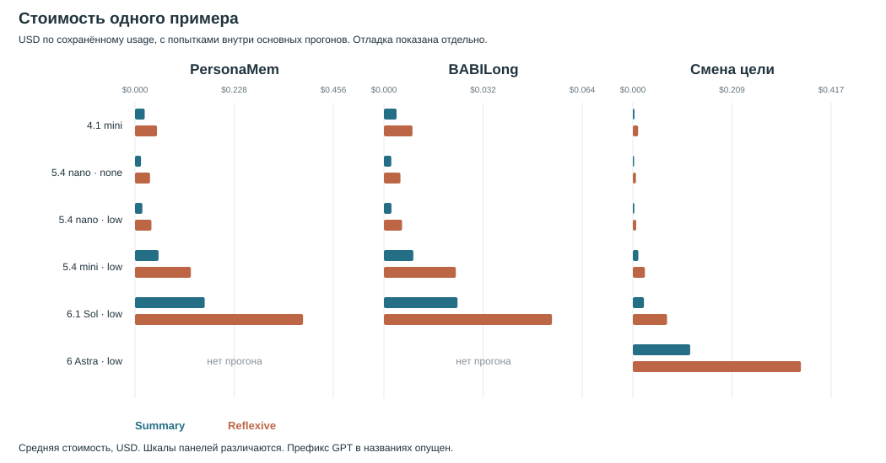

BICA Agent · Эксперименты 9 октября — 1 ноября 2026 года

# Сжатие контекстной памяти языковых моделей

[HTML с каталогом ответов](report.html) · [Краткий PDF](report.summary.pdf) · [Полный PDF](report.pdf) · [Все ответы CSV](../data/all_answers.csv)

Как сохранить полезные сведения, если история длинная, а задача меняется

На изученной выборке дополнительная проверка короткой памяти не дала устойчивого выигрыша в точности и увеличила расходы. После смены задачи успешный ответ часто сопровождался повторным чтением исходных записей.

## Почему короткую память нужно проверять

Языковая модель отвечает по тексту, который получает в текущем запросе. Этот доступный ей текст называется контекстом. Если переписка или история событий становится длинной, её можно читать частями и сохранять краткую запись важных фактов. В этом проекте такая запись называется рабочей памятью.

При сжатии приходится решать, какие сведения оставить. Для выбора дешёвого поставщика важна цена, а код его договора может казаться второстепенным. Если позднее понадобится именно код, в короткой записи его уже может не быть. Поэтому мы проверяем, помогает ли дополнительная проверка памяти точнее отвечать после смены цели и оправдывает ли она расходы.

Для ответа сравниваются два способа обновления памяти. Summary создаёт новую краткую запись за один запрос к модели. Reflexive сначала отбирает факты, затем сжимает их и отдельным запросом проверяет результат. Оба способа получают одинаковый объём памяти и одинаковые задачи.

Сначала в отчёте объясняются методы, задания и условия эксперимента. Затем рассматриваются точность, влияние формы ответа, смена цели и стоимость. Разбор отдельных случаев связывает эти числа с поведением модели, а заключительная часть определяет границы выводов.

## Что модель читает и что сохраняет

История поступает по частям. Исходные фрагменты остаются в отдельном журнале, к которому можно обратиться позднее. После каждого фрагмента модель обновляет короткую рабочую память. Цель, план и последние результаты хранятся в отдельной короткой записи, называемой состоянием. Полная переписка предыдущих запросов автоматически в новый запрос не переносится.

В Summary модель получает прежнюю память и новый текст, после чего сразу пишет обновлённую память. В Reflexive работа разделена на три последовательных запроса. Сначала модель выбирает факты, затем составляет краткую запись, а затем проверяет, сохранились ли выбранные факты в этой записи.

| Метод | Обновление после каждого фрагмента | Запросов |
| --- | --- | --- |
| Summary | Прежняя память и новый текст превращаются в новую память | 1 |
| Reflexive | Отбор фактов, сжатие и проверка выбранного | 3 |

У проверки есть важная граница. Она видит уже отобранные факты и составленную память. Если нужное сведение не попало в первоначальный отбор, проверка не гарантирует его восстановления. В памяти также хранятся идентификаторы исходных фрагментов. Наличие такой ссылки позволяет найти источник, но само по себе не доказывает правильность записанного утверждения.

Когда поступает вопрос, модель может ответить по памяти, сообщить о нехватке данных или запросить повторное чтение. Разрешён один раунд такого обращения с чтением не более двух известных фрагментов. Прочитанный текст снова проходит через тот же способ обновления памяти. Поэтому итог зависит и от сохранённых сведений, и от решения вовремя вернуться к источнику.

## Какие задачи использованы

В исследовании 48 основных примеров из трёх наборов. PersonaMem содержит истории общения о пользователях, их предпочтениях и изменениях этих предпочтений. BABILong проверяет извлечение нужного факта среди длинного отвлекающего текста. Третий набор создан в проекте и проверяет смену задачи на историях о поставщиках.

| Набор | Выборка | Когда известен вопрос | Что засчитывается |
| --- | --- | --- | --- |
| PersonaMem 32k | 16 персон, по одному вопросу | После чтения истории | Правильный вариант a–d |
| BABILong qa1/8k | 20 примеров, строки 5–24 | До чтения истории | Совпадение короткого ответа с эталоном |
| Смена цели | 12 сценариев с поставщиками | Новая цель после первого ответа | Для новой цели нужен точный код договора |

В PersonaMem модель заранее не знает, о чём её спросят. В BABILong она знает вопрос ещё до чтения. В сценарии с поставщиками вопрос меняется после первого ответа. Эти различия важны для отбора фактов, поэтому точности трёх наборов рассматриваются отдельно.

Для PersonaMem дополнительно проверены два способа ответа без последовательного сжатия. «Полный контекст» передаёт всю доступную историю одним запросом. «Последнее окно» передаёт только её конец. Эти варианты помогают понять, даёт ли сжатая память пользу по сравнению с прямым чтением истории.

## Что означает одинаковый размер памяти

Размер текста измеряется токенами, то есть небольшими частями текста, на которые его разбивает программа. Токен не равен слову. Рабочая память обоих методов ограничена 512 токенами. Короткая запись состояния получает ещё 512 токенов. Таким образом, сравнивается работа при одинаковом объёме сохраняемой информации, а затраты на запросы измеряются отдельно.

| Параметр | Лимит в эксперименте |
| --- | --- |
| Рабочая память | 512 токенов |
| Состояние с целью и планом | 512 токенов |
| Текущий запрос с резервом для ответа | 8192 токена |
| Новый фрагмент истории | 2048 токенов |
| Выход одного запроса к модели | 2048 токенов |
| Дополнительные попытки исправить формат | До двух |

Внутри приложения длина текста для всех моделей считается одним измерителем cl100k_base. Для денежного расчёта используется фактическое число токенов, которое сообщил сервис модели. Выходной лимит включает внутреннее рассуждение, если выбранный режим модели его использует. Если ответ нарушает требуемый формат, допускается до двух дополнительных попыток.

У полного контекста PersonaMem отдельный лимит в 65 536 токенов. Последнее окно содержит до 4096 токенов конца истории. Эти способы имеют другие условия доступа к информации, поэтому их результат нельзя считать сравнением при равном размере текущего контекста.

## Что здесь называется платной серией

Платная серия — это группа заранее назначенных запусков через API, программный интерфейс внешнего сервиса языковых моделей. Сервис получает запросы программы и возвращает ответы, а расход рассчитывается по числу обработанных токенов и тарифам эксперимента. Это название отличает такие запуски от локальных проверок и демонстраций с заранее заданными ответами.

Один прогон означает выполнение одной задачи выбранной моделью с одним способом работы с памятью. Он может включать много запросов к сервису, поскольку история читается частями. Поэтому 686 прогонов и 9 683 оплаченных запроса описывают разные величины. Последнее число также включает отладку, то есть предварительные запуски для проверки работоспособности.

Первая серия от 1 ноября 2026 года содержит 512 прогонов. В ней использованы GPT-4.1 mini, GPT-5.4 mini и GPT-5.4 nano с двумя настройками. Продолжение содержит 174 прогона на Sol и Astra. Всего проверено пять моделей, а некоторые из них запускались с разными настройками.

Сочетание модели и её настройки далее называется профилем. Метки none, low и medium обозначают выбранный режим внутреннего рассуждения. Они не меняют лимит памяти. В продолжении Sol low прошёл 128 прогонов на прежней выборке, Astra low — 28 прогонов на её части, а Sol medium — 18 дополнительных проверок без цикла обновления памяти.

Для Astra бюджет позволил проверить девять сценариев смены цели обоими методами и десять вопросов PersonaMem только с последним окном. В режиме Sol medium проверены 16 последних окон и два полных контекста. Размеры этих дополнительных выборок определялись бюджетом. Их нельзя сравнивать с полной выборкой другой модели без отбора одинаковых примеров.

Правильные ответы, называемые эталонами, отделены от входных данных и не передаются агенту. Оценку выполняет программа без дополнительной модели-судьи. В PersonaMem персонажи для отладки и итоговой оценки разделены. Продолжение использует те же примеры итоговой оценки, поэтому оно расширяет сравнение моделей, но не является проверкой на новом независимом наборе.

## Усложнение памяти не дало устойчивого выигрыша

Сначала рассмотрим итоговые ответы по исходным правилам оценки. В первой серии Reflexive на одних сочетаниях модели и набора давал больше верных ответов, а на других меньше. В продолжении Sol решил все задачи BABILong и все сценарии смены цели обоими методами. На PersonaMem Reflexive у Sol дал на один верный ответ меньше.

Рисунок 1. Точность по исходным правилам оценки. Подписи показывают число верных ответов из числа задач. Линии около столбцов — 95% интервалы Wilson, оценка неопределённости доли верных ответов при малой выборке. Это не интервалы разницы методов. Astra проверена на меньшем наборе.

В каждой ячейке таблицы слева указан Summary, справа Reflexive. Например, 8/16 и 7/16 означают восемь и семь верных ответов на одних и тех же 16 задачах. Прочерк означает, что такого прогона не было.

| Модель и режим | PersonaMem | BABILong | Смена цели |
| --- | --- | --- | --- |
| GPT-4.1 mini | 8/16 / 7/16 | 12/20 / 14/20 | 4/12 / 2/12 |
| GPT-5.4 nano · none | 5/16 / 8/16 | 2/20 / 3/20 | 4/12 / 2/12 |
| GPT-5.4 nano · low | 7/16 / 5/16 | 9/20 / 10/20 | 8/12 / 3/12 |
| GPT-5.4 mini · low | 6/16 / 5/16 | 15/20 / 12/20 | 7/12 / 8/12 |
| GPT-6.1 Sol · low | 10/16 / 9/16 | 20/20 / 20/20 | 12/12 / 12/12 |
| GPT-6 Astra · low | — / — | — / — | 9/9 / 9/9 |

Более сильная модель заметно улучшила оба способа памяти. Для сравнения Sol и GPT-5.4 mini на BABILong с Reflexive точное парное p равно 0,0078 по исходной оценке. Однако часть различий связана с формой ответа. Далее разберём эту особенность, прежде чем оценивать убедительность сравнения.

## Почему правильное место могло не засчитаться

Числа выше получены по правилам, установленным до эксперимента. Для BABILong ответ приводится к нижнему регистру, из него убираются пробелы по краям и одна конечная точка. После этого требуется точное совпадение с эталоном. Поэтому the hallway и hallway получают разные оценки, хотя оба ответа называют коридор.

Чтобы понять, насколько результат зависит от этой особенности, выполнен дополнительный пересчёт. Из ответа и эталона после прежней обработки убирается один начальный английский артикль the, a или an с пробелом. Пересчёт сделан после просмотра результатов и показан отдельно. Исходные оценки сохранены.

| Профиль | Summary строго | Summary без артикля | Reflexive строго | Reflexive без артикля |
| --- | --- | --- | --- | --- |
| GPT-4.1 mini | 12/20 | 12/20 | 14/20 | 15/20 |
| GPT-5.4 nano · none | 2/20 | 12/20 | 3/20 | 14/20 |
| GPT-5.4 nano · low | 9/20 | 18/20 | 10/20 | 15/20 |
| GPT-5.4 mini · low | 15/20 | 19/20 | 12/20 | 14/20 |
| GPT-6.1 Sol · low | 20/20 | 20/20 | 20/20 | 20/20 |

У nano none результат Summary меняется с 2 до 12 верных ответов из 20. Значит, десять ответов не были засчитаны только из-за артикля. По одной строгой оценке нельзя заключить, что модель во всех этих случаях забыла нужный факт.

## Как это меняет сравнение настроек nano

В таблице ниже из точности nano low вычтена точность nano none на тех же 20 задачах. Положительная разница означает преимущество low. Значение p получено точным парным тестом Мак-Немара, который учитывает задачи с различающимися исходами. Правила чтения этого показателя объяснены в разделе о неопределённости.

| Метод | Δ строго, п.п. | p строго | Δ без артикля, п.п. | p без артикля |
| --- | --- | --- | --- | --- |
| Summary | +35.0 | 0.0156 | +30.0 | 0.0703 |
| Reflexive | +35.0 | 0.0391 | +5.0 | 1.0000 |

После удаления артикля оба значения p выше 0,05. Убедительность сравнения меняется вместе с правилом оценки. Поэтому исходное различие нельзя целиком объяснить качеством сохранения памяти.

Подробные правила и все спорные фразы доступны в [дополнительном разборе](../analysis/babilong_sensitivity.md). Индивидуальные результаты сохранены в [CSV](../data/babilong_sensitivity.csv) и [JSON](../data/babilong_sensitivity.json). Astra на BABILong не запускалась.

## Ошибки содержания и различия формулировки

Для проверки этого объяснения все 200 ответов BABILong разделены по причине полученной оценки. Это ответы пяти профилей с двумя методами на одних и тех же 20 задачах. Повторение задач не увеличивает число независимых примеров до 200.

| Категория | Ответов |
| --- | --- |
| Строгое совпадение | 117 |
| Различие только в артикле | 42 |
| Указано другое место | 18 |
| Недостаточно данных | 14 |
| Требуется разбор фразы | 9 |
| Ошибка выполнения / статуса | 0 |

Категория «Указано другое место» применяется, когда ответ и эталон называют разные места из фиксированного словаря bathroom, bedroom, garden, hallway, kitchen и office. Сообщение модели о нехватке данных, сохранённое как insufficient_data, учитывается отдельно. Такой ответ не приносит балла, но отличается от уверенного указания неверного места.

Девять более сложных фраз требуют отдельного разбора. Два ответа, Daniel is in the office. и Mary is in the hallway., явно содержат эталонное место. Даже дополнительное удаление артикля их не засчитывает, поскольку оно не оценивает смысл целого предложения.

| Ответ | Эталон | Как понимать различие |
| --- | --- | --- |
| the hallway | hallway | Разница только в начальном артикле |
| Daniel is in the office. | office | Нужное место названо внутри предложения |
| hallway, then kitchen | kitchen | Названы два места, нужен отдельный разбор |

Такое разделение помогает увидеть границы оценки. Строгое несовпадение может означать потерю факта, отказ отвечать или неподходящую форму ответа. Эти причины нельзя считать одним и тем же сбоем памяти.

## Как читать разницу точности

Методы сравниваются попарно на одних и тех же задачах. Из точности Reflexive вычитается точность Summary. Эта разница обозначена Δ и измеряется в процентных пунктах, сокращённо п.п. Например, рост с 50% до 60% составляет 10 процентных пунктов. Положительная Δ означает преимущество Reflexive.

При малом числе задач разница может заметно меняться от состава выборки. Для оценки этой неустойчивости в сохранённом анализе 10 000 раз собирались новые выборки из имеющихся пар с возвращением. Такой способ называется парным bootstrap. Полученный 95% интервал показывает диапазон оценок разницы при этом пересчёте. Он не охватывает все источники неопределённости, в частности вариативность новых запусков модели.

Дополнительно приведено p точного теста Мак-Немара. При предположении, что у методов одинаковы шансы выигрывать на задачах с разными исходами, p показывает вероятность получить столь же сильный или более сильный перекос. В исследовании использован обычный порог 0,05. Значение выше порога означает нехватку оснований заявить различие, но не доказывает равенство методов.

| Набор | Профиль | Пар | Δ, п.п. | 95% интервал, п.п. | p |
| --- | --- | --- | --- | --- | --- |
| BABILong | GPT-4.1 mini | 20 | +10.00 | -15.00 … +35.00 | 0.7266 |
| BABILong | GPT-5.4 nano · low | 20 | +5.00 | -15.00 … +25.00 | 1.0000 |
| BABILong | GPT-5.4 mini · low | 20 | -15.00 | -45.00 … +15.00 | 0.5078 |
| BABILong | GPT-5.4 nano · none | 20 | +5.00 | +0.00 … +15.00 | 1.0000 |
| Смена цели | GPT-4.1 mini | 12 | -16.67 | -58.33 … +25.00 | 0.6875 |
| Смена цели | GPT-5.4 nano · low | 12 | -41.67 | -75.00 … -8.33 | 0.1250 |
| Смена цели | GPT-5.4 mini · low | 12 | +8.33 | -25.00 … +41.67 | 1.0000 |
| Смена цели | GPT-5.4 nano · none | 12 | -16.67 | -50.00 … +16.67 | 0.6250 |
| PersonaMem | GPT-4.1 mini | 16 | -6.25 | -31.25 … +18.75 | 1.0000 |
| PersonaMem | GPT-5.4 nano · low | 16 | -12.50 | -43.75 … +18.75 | 0.6875 |
| PersonaMem | GPT-5.4 mini · low | 16 | -6.25 | -25.00 … +12.50 | 1.0000 |
| PersonaMem | GPT-5.4 nano · none | 16 | +18.75 | +0.00 … +37.50 | 0.2500 |
| PersonaMem | GPT-6.1 Sol · low | 16 | -6.25 | -25.00 … +12.50 | 1.0000 |
| BABILong | GPT-6.1 Sol · low | 20 | +0.00 | +0.00 … +0.00 | 1.0000 |
| Смена цели | GPT-6.1 Sol · low | 12 | +0.00 | +0.00 … +0.00 | 1.0000 |
| Смена цели | GPT-6 Astra · low | 9 | +0.00 | +0.00 … +0.00 | 1.0000 |

У Sol на PersonaMem разница равна −6,25 п.п., а интервал простирается от −25 до +12,5 п.п. Наблюдения совместимы с изменениями в обе стороны. Ни одно из показанных сравнений методов не имеет p ниже 0,05.

Интервал и p рассчитаны разными способами, поэтому на малой выборке могут давать неодинаковые ориентиры. Все значения p приведены без поправки на число сравнений. При множественных проверках случайное обнаружение различия становится вероятнее. Нулевой интервал при одинаково верных ответах описывает только наблюдаемую выборку и не доказывает равенство на новых задачах.

## Что даёт прямое чтение всей истории

Предыдущие разделы сравнивали два способа сжатия. Дополнительные проверки PersonaMem позволяют поставить другой вопрос. Нужно ли вообще сжимать историю, если она помещается в один запрос и в конце требуется ответить только на один вопрос?

Полный контекст дал больше верных ответов, чем Summary, у всех пяти основных профилей. По сравнению с Reflexive исключением оказался nano none. У него полный контекст дал 6 верных ответов из 16, а Reflexive — 8. Пять профилей здесь включают две настройки одной модели nano.

Рисунок 2. Число верных ответов на 16 одинаковых задачах PersonaMem. Последнее окно содержит только конец истории, а полный контекст получает всю историю с большим лимитом запроса.

На примере Sol можно сопоставить точность с затратами. Таблица относится к одним и тем же 16 вопросам. Денежные суммы указаны в долларах США, а число запросов включает обработку фрагментов и получение ответа.

| Sol low на PersonaMem | Верно | USD за 16 задач | Запросы |
| --- | --- | --- | --- |
| Последнее окно | 5/16 | 0,1860 | 16 |
| Summary | 10/16 | 2,5664 | 270 |
| Reflexive | 9/16 | 6,1878 | 751 |
| Полный контекст | 13/16 | 1,0564 | 16 |

Полный контекст оказался и точнее, и дешевле обоих способов сжатия в этом условии. Причина, согласующаяся с устройством программы, состоит в повторной обработке текста. При сжатии инструкции, память и новые фрагменты отправляются много раз. Малый размер одного запроса поэтому не гарантирует малого суммарного расхода.

Этот результат относится к историям данного размера и одному итоговому вопросу. Он не показывает, что произойдёт при множестве последующих вопросов или при окне, в которое вся история не помещается. Такие условия отдельно не проверялись.

## От выбора поставщика к поиску кода договора

Сценарий с поставщиками проверяет, сохранится ли информация, которая сначала была второстепенной. Вначале модель выбирает самого дешёвого поставщика с доставкой до пяти дней. После первого ответа цена перестаёт быть главным условием. Теперь нужно назвать код договора самого быстрого поставщика независимо от цены.

Первая оценка показывает, справилась ли модель с исходным выбором. Вторая относится к новой цели до обращения к источнику. Третья показывает итог после разрешённого повторного чтения. В каждой ячейке указано число верных ответов из числа сценариев.

| Профиль | Метод | Первая цель | Новая цель до поиска | Новая цель итог | Поиски |
| --- | --- | --- | --- | --- | --- |
| GPT-4.1 mini | Summary | 12/12 | 3/12 | 4/12 | 1 |
| GPT-4.1 mini | Reflexive | 11/12 | 2/12 | 2/12 | 0 |
| GPT-5.4 nano · none | Summary | 10/12 | 4/12 | 4/12 | 1 |
| GPT-5.4 nano · none | Reflexive | 12/12 | 2/12 | 2/12 | 1 |
| GPT-5.4 nano · low | Summary | 12/12 | 5/12 | 8/12 | 4 |
| GPT-5.4 nano · low | Reflexive | 12/12 | 3/12 | 3/12 | 0 |
| GPT-5.4 mini · low | Summary | 11/12 | 7/12 | 7/12 | 2 |
| GPT-5.4 mini · low | Reflexive | 12/12 | 4/12 | 8/12 | 4 |
| GPT-6.1 Sol · low | Summary | 12/12 | 2/12 | 12/12 | 10 |
| GPT-6.1 Sol · low | Reflexive | 12/12 | 3/12 | 12/12 | 9 |
| GPT-6 Astra · low | Summary | 9/9 | 2/9 | 9/9 | 7 |
| GPT-6 Astra · low | Reflexive | 9/9 | 2/9 | 9/9 | 7 |

Например, Sol с Summary решил исходную задачу во всех 12 сценариях. На новый вопрос до поиска он ответил правильно только в двух. Итоговый результат составил 12 из 12. Поэтому высокая итоговая точность ещё не означает, что все нужные сведения сохранялись в короткой памяти.

Столбец «Поиски» считает обращения к источникам за весь прогон, включая первую цель. Astra проверена на девяти сценариях. Отдельное условие с отключённым поиском не запускалось.

## Почему итоговый ответ не описывает одну лишь память

При смене цели Sol до поиска правильно отвечал в 2 из 12 сценариев с Summary и в 3 из 12 с Reflexive. После разрешённого повторного чтения оба метода дали 12 из 12. У Astra на девяти общих сценариях результат изменился с 2 до 9 верных ответов в обоих режимах.

Рисунок 3. Результат на новой цели до поиска и в конце прогона. Пустая точка показывает оценку до поиска, закрашенная — итог. Подпись справа показывает переход и число сценариев. При равных результатах точки совпадают.

Это наблюдение поддерживает предположение о пользе возврата к исходным записям. Однако решение искать принимала сама модель, а полученный текст затем снова проходил через обновление памяти. Отдельного условия с принудительно отключённым поиском нет. Поэтому весь прирост нельзя приписать только одному компоненту системы.

Некоторые менее сильные модели отвечали без необходимых сведений и не обращались к источнику. Это указывает на ещё один возможный источник ошибки. Недостаточно сохранить ссылку на запись, нужно также распознать нехватку данных и решить ею воспользоваться. Ниже это показано на конкретном прогоне.

## Дополнительные запросы увеличили расходы

У Reflexive три запроса на обновление каждого фрагмента вместо одного у Summary. В первой серии его суммарная стоимость была выше в 2,2–3,3 раза, а у Sol — в 2,3–3,1 раза. Соотношение отличается от трёх, поскольку меняются длины запросов, ответов и число дополнительных действий.

На девяти одинаковых сценариях смены цели Astra обошлась примерно в пять раз дороже Sol при одинаковой итоговой точности. Это сравнение относится только к этим сценариям.

Рисунок 4. Средняя стоимость одной задачи в долларах США. Шкалы трёх панелей различаются. Выборка Astra меньше, поэтому сопоставление моделей требует одинакового состава задач.

Таблица показывает затраты основных прогонов по профилям. Отладка в неё не входит и учтена отдельно в общем расходе.

| Профиль | Прогоны | Запросы | USD, основные прогоны |
| --- | --- | --- | --- |
| GPT-4.1 mini | 128 | 1694 | 1.803076 |
| GPT-5.4 nano · none | 128 | 1723 | 1.135381 |
| GPT-5.4 nano · low | 128 | 1733 | 1.263926 |
| GPT-5.4 mini · low | 128 | 1740 | 4.403073 |
| GPT-6.1 Sol · low | 128 | 1860 | 12.692862 |
| GPT-6 Astra · low | 28 | 313 | 4.844347 |
| GPT-6.1 Sol · medium | 18 | 18 | 0.298306 |

Основные прогоны стоили $26,44097159, отладка — $1,43534270. Общий расход составил $27,87631429 при бюджете $28. Осталось $0,12368571. Учтены 9 683 оплаченных запроса. Суммы рассчитаны по сохранённым сведениям об использовании токенов и тарифам эксперимента от 1 ноября 2026 года.

Заранее установленного порога, при котором прирост точности считался бы оправданием расходов, не было. На этой выборке Reflexive стоил дороже без устойчивого общего выигрыша. Это основание для осторожного практического вывода в условиях эксперимента, но не универсальная оценка окупаемости.

## Нужный факт не попал в сохранённую память

Сводные числа не объясняют каждую ошибку. Для подробного разбора доступны четыре полных журнала, по два метода на двух сценариях. Они показывают исходные запросы, ответы и изменения памяти. В каждой группе выбран первый по идентификатору случай, в котором методы дали разные результаты. Такой выбор помогает показать механизм, но не оценить его частоту.

В сценарии goal-shift-000 у nano low после смены цели требовался код AG-10894-7 для поставщика Vendor-00-H. Summary запросил исходные фрагменты и вернул этот код. Reflexive сохранил сроки доставки, но отбросил коды договоров. Затем он ответил именем поставщика и не запросил повторное чтение.

| Метод | Действие | Ответ | Оценка |
| --- | --- | --- | --- |
| Summary | Перечитал фрагменты c001 и c004 | AG-10894-7 | Верно |
| Reflexive | Ответил без поиска | Vendor-00-H | Нужен был код договора |

В этом случае проверяющая стадия не вернула сведения, отсутствующие в первоначальном отборе. Технический формат ответа и лимиты были соблюдены. Ошибка связана с содержанием памяти и последующим решением ответить без поиска.

## Сохранённая альтернатива помогла изменить выбор

В сценарии goal-shift-001 у mini low первая цель привела оба метода к Vendor-01-D. После смены приоритета требовался более быстрый Vendor-01-B с кодом AG-88779-1. Summary ошибочно счёл прежнего поставщика самым быстрым. Reflexive сохранил сведения об альтернативе и вернул правильный код без поиска.

| Метод | Ответ | Эталон | Оценка |
| --- | --- | --- | --- |
| Summary | AG-68601-3 | AG-88779-1 | Неверно |
| Reflexive | AG-88779-1 | AG-88779-1 | Верно |

Два случая объясняют, почему дополнительная проверка может и не помочь, и оказаться полезной. Результат зависит от того, какие факты были отобраны до сжатия и что понадобится для следующей задачи. Полные записи этих четырёх прогонов находятся в examples/openai-20261101/cases/.

## Вывод в пределах проведённой проверки

На этой выборке трёхстадийное обновление памяти не показало устойчивого преимущества перед одношаговым, хотя требовало больше расходов. Переход к более сильной модели улучшил оба метода. После смены цели успешный ответ часто сопровождался возвратом к исходным записям. Для одного вопроса PersonaMem прямое чтение всей истории оказалось конкурентным по точности и стоимости.

Эти результаты получены на небольших наборах из 16, 20 и 12 задач. Для каждой комбинации выполнен только один прогон, поэтому вариативность повторных запусков не измерена. Astra прошла часть заданий, а продолжение использовало прежние примеры. Проверка на новом независимом наборе ещё нужна.

Сравнение меняет весь способ работы с памятью, включая инструкции и число запросов. Оно не выделяет отдельный вклад проверяющей стадии. Нет и отдельного условия с отключённым поиском. Собственные сценарии смены цели остаются короткими текстовыми задачами о поставщиках. Поведение в среде с реальными действиями здесь не исследовалось.

У BABILong оценка зависит от формулировки ответа. Дополнительный пересчёт с удалением артикля введён после просмотра результатов и не заменяет исходную оценку. Он также не оценивает смысл сложных фраз. Эти ограничения нужно учитывать при объяснении различий между моделями.

## Откуда взяты результаты и что можно проверить

Отчёт собран из сохранённых протоколов, итоговых ответов, таблиц расходов и доступных журналов запросов. При сборке сверены состав задач, все 686 итоговых ответов с сохранёнными эталонами, сводные числа и денежные суммы. Контрольные суммы SHA-256 в файле verification.json позволяют установить, какие версии исходных файлов использованы.

Полные исходные истории и журналы большинства обращений к внешним моделям в репозитории отсутствуют. Поэтому можно проверить опубликованные сводки и доступные записи, но нельзя независимо восстановить все промежуточные стадии или заново проверить извлечение всех эталонов. Дословные вопросы доступны для пяти примеров BABILong и двух сценариев смены цели. Остальные вопросы и варианты ответов по догадке не восстанавливались.

Источниками наборов служат bowen-upenn/PersonaMem в варианте 32k и RMT-team/babilong-1k-samples в варианте qa1/8k. Их версии и контрольные суммы записаны в файлах manifest. Идентификаторы Sol и Astra не привязаны к дате выпуска, поэтому точные веса моделей для будущего повторения не зафиксированы.

## Какой эксперимент нужен дальше

Следующая проверка должна использовать новые, более сложные смены цели и несколько повторов каждого условия. Сравнение с отключённым поиском поможет отделить качество сохранения памяти от способности вовремя перечитать источник. Отдельное изменение проверяющей стадии позволит оценить именно её вклад. Пока такие эксперименты не проведены, вывод остаётся ограниченным описанными условиями.

Редакция от 18 ноября 2026 года. Подготовлено по сохранённым материалам без новых запросов к моделям.
