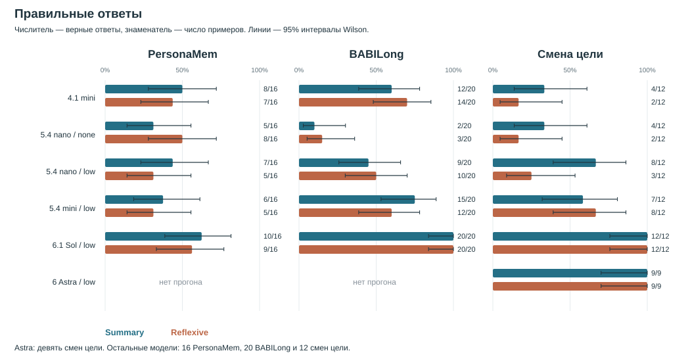
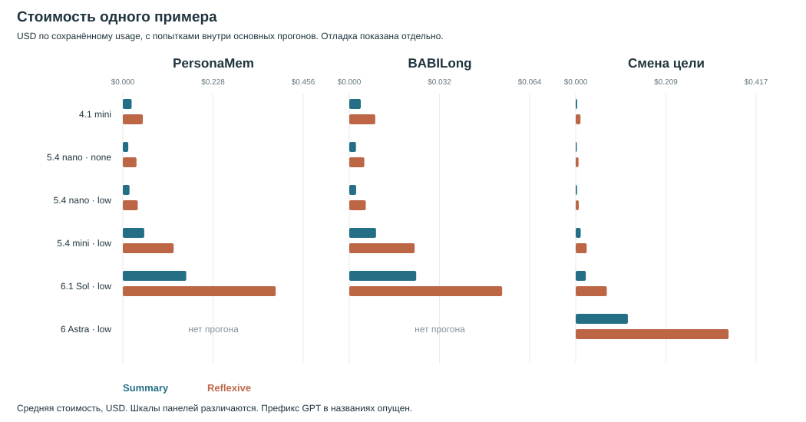

# Сжатие контекстной памяти языковых моделей

При памяти 512 токенов Reflexive не показал устойчивого выигрыша перед Summary. Дополнительные стадии увеличили расходы. Две серии включают 686 прогонов на 48 основных примерах.

Вопрос исследования: помогает ли трёхстадийное обновление точнее отвечать после смены цели при одинаковом размере памяти и оправдывает ли результат дополнительные расходы? Сравниваются полные процессы; вклад одной проверяющей стадии отдельно не установлен.

[Наглядный отчёт HTML](report.html) · [Краткий отчёт PDF](report.summary.pdf) · [PDF со всеми ответами](report.pdf) · [Все ответы CSV](all_answers.csv)

## Основные результаты

Исходная строгая метрика. Сначала Summary, затем Reflexive. У Astra девять сценариев смены цели.

| Модель | PersonaMem | BABILong | Смена цели |
| --- | --- | --- | --- |
| GPT-4.1 mini | 8/16 / 7/16 | 12/20 / 14/20 | 4/12 / 2/12 |
| GPT-5.4 nano · none | 5/16 / 8/16 | 2/20 / 3/20 | 4/12 / 2/12 |
| GPT-5.4 nano · low | 7/16 / 5/16 | 9/20 / 10/20 | 8/12 / 3/12 |
| GPT-5.4 mini · low | 6/16 / 5/16 | 15/20 / 12/20 | 7/12 / 8/12 |
| GPT-6.1 Sol · low | 10/16 / 9/16 | 20/20 / 20/20 | 12/12 / 12/12 |
| GPT-6 Astra · low | — / — | — / — | 9/9 / 9/9 |

## BABILong: форма ответа

Исходные строгие оценки сохранены. Отдельный ретроспективный пересчёт удаляет только один начальный английский артикль после прежней нормализации. Это не полная смысловая оценка.

| Профиль | Summary: строго | Summary: без артикля | Reflexive: строго | Reflexive: без артикля |
| --- | --- | --- | --- | --- |
| GPT-4.1 mini | 12/20 | 12/20 | 14/20 | 15/20 |
| GPT-5.4 nano · none | 2/20 | 12/20 | 3/20 | 14/20 |
| GPT-5.4 nano · low | 9/20 | 18/20 | 10/20 | 15/20 |
| GPT-5.4 mini · low | 15/20 | 19/20 | 12/20 | 14/20 |
| GPT-6.1 Sol · low | 20/20 | 20/20 | 20/20 | 20/20 |

[Категории ответов, сложные фразы и сравнения](babilong_sensitivity.md).

## Два этапа смены цели

| Профиль | Метод | Первая цель | Новая: до поиска | Новая: итог | Поиски |
| --- | --- | --- | --- | --- | --- |
| GPT-4.1 mini | Summary | 12/12 | 3/12 | 4/12 | 1 |
| GPT-4.1 mini | Reflexive | 11/12 | 2/12 | 2/12 | 0 |
| GPT-5.4 nano · none | Summary | 10/12 | 4/12 | 4/12 | 1 |
| GPT-5.4 nano · none | Reflexive | 12/12 | 2/12 | 2/12 | 1 |
| GPT-5.4 nano · low | Summary | 12/12 | 5/12 | 8/12 | 4 |
| GPT-5.4 nano · low | Reflexive | 12/12 | 3/12 | 3/12 | 0 |
| GPT-5.4 mini · low | Summary | 11/12 | 7/12 | 7/12 | 2 |
| GPT-5.4 mini · low | Reflexive | 12/12 | 4/12 | 8/12 | 4 |
| GPT-6.1 Sol · low | Summary | 12/12 | 2/12 | 12/12 | 10 |
| GPT-6.1 Sol · low | Reflexive | 12/12 | 3/12 | 12/12 | 9 |
| GPT-6 Astra · low | Summary | 9/9 | 2/9 | 9/9 | 7 |
| GPT-6 Astra · low | Reflexive | 9/9 | 2/9 | 9/9 | 7 |

Поиски учитываются за весь прогон, включая первую цель. Различие до/после поиска не изолирует его причинный эффект.

## Парные различия методов

| Набор | Профиль | Пар | Δ, п.п. | 95% bootstrap, п.п. | p |
| --- | --- | --- | --- | --- | --- |
| BABILong | GPT-4.1 mini | 20 | +10.00 | -15.00 … +35.00 | 0.7266 |
| BABILong | GPT-5.4 nano · low | 20 | +5.00 | -15.00 … +25.00 | 1.0000 |
| BABILong | GPT-5.4 mini · low | 20 | -15.00 | -45.00 … +15.00 | 0.5078 |
| BABILong | GPT-5.4 nano · none | 20 | +5.00 | +0.00 … +15.00 | 1.0000 |
| Смена цели | GPT-4.1 mini | 12 | -16.67 | -58.33 … +25.00 | 0.6875 |
| Смена цели | GPT-5.4 nano · low | 12 | -41.67 | -75.00 … -8.33 | 0.1250 |
| Смена цели | GPT-5.4 mini · low | 12 | +8.33 | -25.00 … +41.67 | 1.0000 |
| Смена цели | GPT-5.4 nano · none | 12 | -16.67 | -50.00 … +16.67 | 0.6250 |
| PersonaMem | GPT-4.1 mini | 16 | -6.25 | -31.25 … +18.75 | 1.0000 |
| PersonaMem | GPT-5.4 nano · low | 16 | -12.50 | -43.75 … +18.75 | 0.6875 |
| PersonaMem | GPT-5.4 mini · low | 16 | -6.25 | -25.00 … +12.50 | 1.0000 |
| PersonaMem | GPT-5.4 nano · none | 16 | +18.75 | +0.00 … +37.50 | 0.2500 |
| PersonaMem | GPT-6.1 Sol · low | 16 | -6.25 | -25.00 … +12.50 | 1.0000 |
| BABILong | GPT-6.1 Sol · low | 20 | +0.00 | +0.00 … +0.00 | 1.0000 |
| Смена цели | GPT-6.1 Sol · low | 12 | +0.00 | +0.00 … +0.00 | 1.0000 |
| Смена цели | GPT-6 Astra · low | 9 | +0.00 | +0.00 … +0.00 | 1.0000 |

Δ — Reflexive минус Summary, исходная метрика. Интервалы — сохранённый парный bootstrap; p без поправок. Нулевое различие на выборке не доказывает равенства методов.

## Как объяснить результат

Проверка Reflexive сохраняет отобранные факты, но не гарантирует полноту самого отбора. После смены цели нужное поле может отсутствовать в памяти. У Sol повторное чтение подняло результат с 2/12 до 12/12 для Summary и с 3/12 до 12/12 для Reflexive.

На PersonaMem полный контекст Sol дал 13/16 за $1,0564. Summary — 10/16 за $2,5664, Reflexive — 9/16 за $6,1878. Полный контекст использовал большее окно. Это контроль для одного вопроса, а не сравнение при равном окне.

## Материалы

[Все итоговые ответы JSON](all_answers.json). [Сохранённые контрольные точки](archived_answers.json). [Доступные промежуточные ответы](saved_stage_responses.json). [Карточки задач и источники вопросов](example_contexts.json). В HTML ID ответа открывает карточку с вопросом, эталоном, сопоставлением моделей и пояснением оценки. Дословные вопросы найдены для пяти BABILong и двух смен цели; остальные вопросы и варианты не восстановлены предположительно.

## Ограничения

Один прогон на комбинацию, небольшие выборки и несколько сравнений. Продолжение использует те же eval-примеры. Нет отдельного контроля без поиска. Astra прошла меньшую выборку. Большинство полных платных трасс и исходные датасеты отсутствуют в клоне. Полный независимый аудит всех стадий по сводкам невозможен.

## Происхождение

Источники и SHA-256: [verification.json](verification.json). Учтено 9 683 платных запроса с отладкой на $27,87631429. Пересчитаны ответы по сохранённым эталонам и суммы. Новых модельных запросов нет. Редакция — 18 ноября 2026 года.
