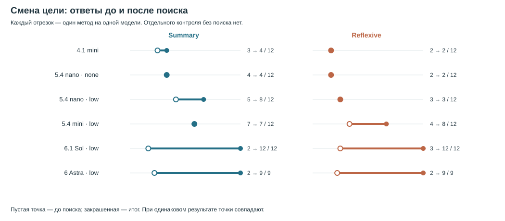
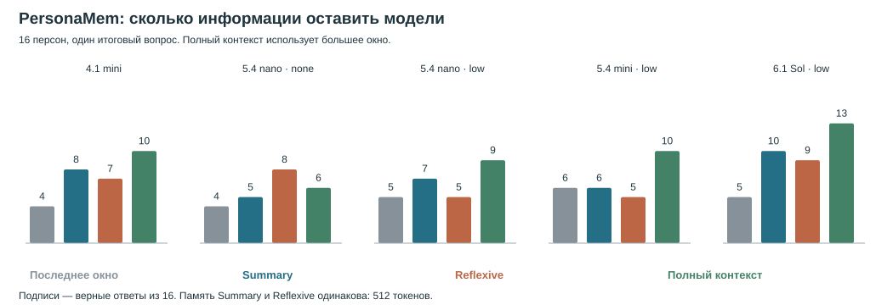

# Сжатие контекстной памяти языковых моделей

При памяти 512 токенов Reflexive не показал устойчивого выигрыша перед Summary. Дополнительные стадии увеличили расходы. Две серии включают 686 прогонов на 48 основных примерах.

[Наглядный отчёт HTML](report.html) · [Краткий отчёт PDF](report.summary.pdf) · [PDF со всеми ответами](report.pdf) · [Все ответы CSV](all_answers.csv)

## Основные результаты

Сначала Summary, затем Reflexive. У Astra девять сценариев смены цели.

| Модель | PersonaMem | BABILong | Смена цели |
| --- | --- | --- | --- |
| GPT-4.1 mini | 8/16 / 7/16 | 12/20 / 14/20 | 4/12 / 2/12 |
| GPT-5.4 nano · none | 5/16 / 8/16 | 2/20 / 3/20 | 4/12 / 2/12 |
| GPT-5.4 nano · low | 7/16 / 5/16 | 9/20 / 10/20 | 8/12 / 3/12 |
| GPT-5.4 mini · low | 6/16 / 5/16 | 15/20 / 12/20 | 7/12 / 8/12 |
| GPT-6.1 Sol · low | 10/16 / 9/16 | 20/20 / 20/20 | 12/12 / 12/12 |
| GPT-6 Astra · low | — / — | — / — | 9/9 / 9/9 |

## Как объяснить результат

Проверка Reflexive сохраняет отобранные факты, но не гарантирует полноту самого отбора. После смены цели нужное поле может отсутствовать в памяти. У Sol повторное чтение подняло результат с 2/12 до 12/12 для Summary и с 3/12 до 12/12 для Reflexive.

На PersonaMem полный контекст Sol дал 13/16 за $1,0564. Summary — 10/16 за $2,5664, Reflexive — 9/16 за $6,1878. Полный контекст использовал большее окно. Это контроль для одного вопроса, а не сравнение при равном окне.

## Материалы

[Все итоговые ответы JSON](all_answers.json). [Сохранённые контрольные точки](archived_answers.json). [Доступные промежуточные ответы](saved_stage_responses.json). Отсутствующие вопросы и ответы не восстановлены предположительно.

## Ограничения

Один прогон на комбинацию, небольшие выборки и несколько сравнений. Продолжение использует те же eval-примеры. Нет отдельного контроля без поиска. Astra прошла меньшую выборку. Большинство полных платных трасс и исходные датасеты отсутствуют в клоне. Полный независимый аудит всех стадий по сводкам невозможен.

## Происхождение

Источники и SHA-256: [verification.json](verification.json). Учтено 9 683 платных запроса с отладкой на $27,87631429. Пересчитаны ответы по сохранённым эталонам и суммы. Новых модельных запросов нет. Редакция — 18 ноября 2026 года.
