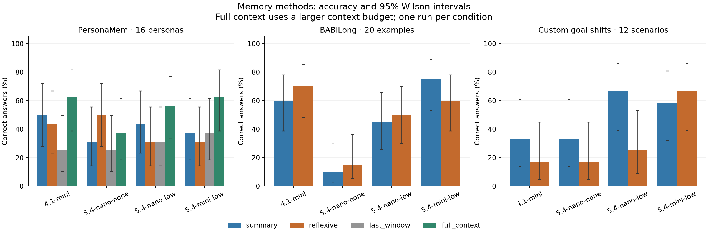
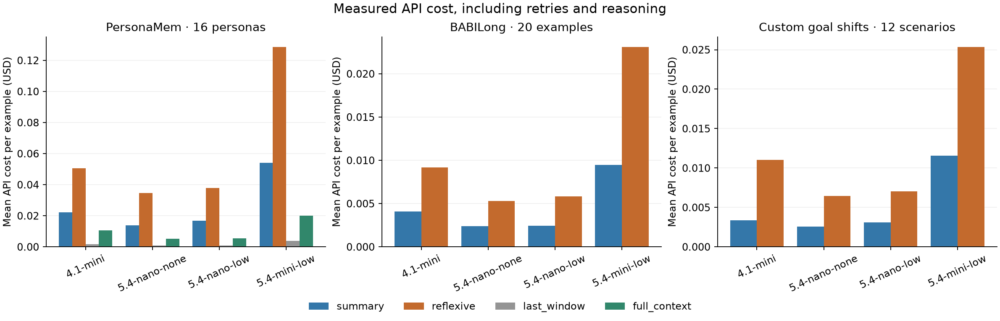

# OpenAI: первый эксперимент

512 прогонов на 48 задачах, три модели и четыре настройки model/reasoning. Все прогоны завершены. Оценка — кодом по эталонам, без модели-судьи. Расход с отладкой: **$9.37739709**, из выделенных $28 не использовано **$18.62260291**. Это расчёт по usage, а не показание баланса аккаунта.

## Что получилось

Точность ниже записана как **summary / reflexive**:

| Модель | PersonaMem, 16 | BABILong, 20 | Смена цели, 12 |
|---|---:|---:|---:|
| GPT-4.1 mini | 8 / 7 | 12 / 14 | 4 / 2 |
| GPT-5.4 nano, low | 7 / 5 | 9 / 10 | 8 / 3 |
| GPT-5.4 mini, low | 6 / 5 | 15 / 12 | 7 / 8 |
| GPT-5.4 nano, none | 5 / 8 | 2 / 3 | 4 / 2 |

`reflexive` стоил в 2.2–3.3 раза дороже `summary`. Устойчивого преимущества по точности не обнаружено: ни одно из 12 парных сравнений методов не достигло p < 0.05 по точному McNemar даже без поправки на множественные проверки. Это не доказательство равенства методов: выборки небольшие, интервалы широкие.

На BABILong reasoning `low` у nano дал 9/20 вместо 2/20 для summary и 10/20 вместо 3/20 для reflexive. Для PersonaMem картина другая: reflexive с `none` оказался лучше `low` в этом прогоне. Эффект reasoning зависит от задачи; одного прогона недостаточно для общего вывода.

Полный контекст на PersonaMem дал 10/16 для GPT-4.1 mini и GPT-5.4 mini, 9/16 для nano low, 6/16 для nano none. Он оказался дешевле обоих методов последовательного сжатия. Для истории около 32k и одного итогового вопроса полезность такого сжатия пока не подтверждена. Полный контекст использовал большее окно; при жёстком ограничении окна это не равнозначная замена.

Повторное чтение помогло GPT-5.4 mini/reflexive на смене цели: 4/12 до поиска и 8/12 после. Но модели часто отвечали из неполной памяти, вообще не запрашивая источник. [Два разобранных примера](cases.md) показывают и пользу, и сбой метода.

Следующая проверяемая гипотеза: при смене цели нужно проверять полноту сведений и при необходимости перечитывать источник. Текущий `verify` сравнивает только уже выбранные факты и не восстанавливает отброшенные альтернативы. Промпты после просмотра этих eval-результатов не менялись.

## Материалы

- [Полный отчёт](report.md): точность, интервалы, парные сравнения, retrieval, reasoning tokens, стоимость и время.
- [Протокол](protocol.json): модели, выборка, порядок заданий, лимиты, цены и хеши.
- [Все предсказания, CSV](predictions.csv) и [машиночитаемые результаты](results.json).
- [Учёт 7 388 запросов генерации](receipts.csv), включая 498 отладочных. Основная серия: 6 890 запросов, $8.60545639. Бесплатные запросы метаданных сюда не входят.
- [Аудит](audit.json): полный исходный текст во всех 384 прогонах с памятью, память не более 512 токенов, запросы этих методов с резервом не более 6308 при лимите 8192. Неизвестных расходов нет.
- [PersonaMem manifest](personamem-manifest.json), [BABILong manifest](babilong-manifest.json).

Графики также доступны в SVG и PDF. Полные локальные журналы находятся в `runs/openai-first-20261101/tasks/`; пути в CSV/JSON относятся к этому каталогу эксперимента. В репозитории сохранены полные трассы четырёх показательных прогонов в `cases/`, остальные исходные истории здесь не дублируются. Повторить эксперимент можно по [инструкции](../../docs/openai-experiment.md).

Небольшие выборки и один прогон на комбинацию делают это пилотным исследованием. Синтетическая смена цели — наш диагностический набор, не AgentChangeBench. Дополнительные рабочие процессы обрабатывали часть той же заранее назначенной очереди; выборка и настройки не менялись.
