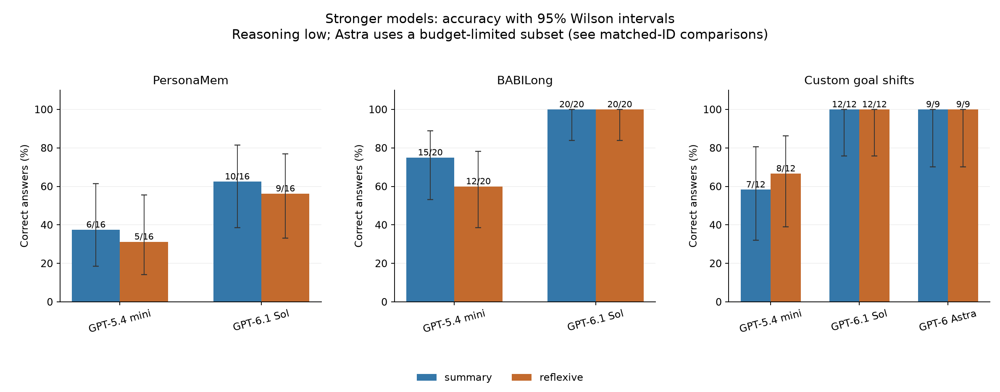
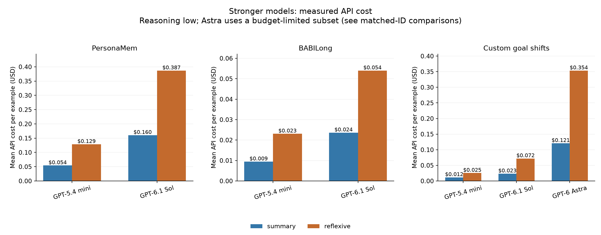

# Продолжение эксперимента: Sol и Astra

174 дополнительных прогона, все завершены без ошибок. GPT-6.1 Sol прошёл всю прежнюю выборку: 128 прогонов с reasoning `low`. GPT-6 Astra — 18 прогонов на девяти сменах цели и 10 контролей с последним окном. Ещё 18 контрольных ответов получены от Sol с `medium`.

Расход продолжения с отладкой — **$18.49891720**, обеих серий — **$27.87631429 из $28**. Осталось **$0.12368571**. Это расчёт по usage, не показание баланса аккаунта. Всего в двух сериях 686 прогонов пяти моделей.

## Что изменилось с более сильной моделью

Числа в таблице — верные ответы **summary / reflexive** на одинаковых примерах, reasoning `low`:

| Модель | PersonaMem, 16 | BABILong, 20 | Смена цели, 12 |
|---|---:|---:|---:|
| GPT-5.4 mini, первая серия | 6 / 5 | 15 / 12 | 7 / 8 |
| GPT-6.1 Sol | 10 / 9 | 20 / 20 | 12 / 12 |

Sol улучшил результат обоих методов. Но преимущество `reflexive` над `summary` не появилось: на PersonaMem он дал на один правильный ответ меньше, на других наборах — столько же. При этом `reflexive` стоил в 2.3–3.1 раза дороже.

На девяти одинаковых сценариях смены цели Astra и Sol дали **9/9 в обоих режимах**. Astra стоил в 5.0–5.2 раза дороже. Эти задачи уже не различают сильные модели по итоговой точности. Это не означает, что модели равноценны на более сложных задачах.

Полный контекст Sol на PersonaMem дал **13/16** за $1.06; summary — 10/16 за $2.57, reflexive — 9/16 за $6.19. При доступном окне 32k+ и одном вопросе последовательное сжатие пока не оправдывает свою стоимость. Полный контекст использует большее окно, поэтому сравнение не заменяет эксперимент при жёстком ограничении доступного контекста.

## Что сработало при смене цели

У Sol до поиска в источнике было **2/12** для summary и **3/12** для reflexive; после поиска — **12/12** у обоих. У Astra на её девяти примерах было 2/9 до поиска и 9/9 после у обоих методов. Сильные модели чаще использовали доступное повторное чтение и восстанавливали нужные сведения. Результат поддерживает дальнейшую проверку поиска при смене цели; сам по себе он не доказывает пользу трёх стадий сжатия.

Проверка Sol `medium` касалась только одношаговых ответов: последние окна PersonaMem — 5/16 при обоих режимах reasoning; полный контекст — 1/2 у обоих на двух совпадающих примерах. По этой малой проверке нельзя судить о пользе medium для всего процесса сжатия.

## Насколько надёжен вывод

Выборки небольшие, один прогон на комбинацию. Это продолжение на тех же данных, а не новый независимый тест. Промпты и методы памяти после первой серии не менялись; ответы оценены кодом по эталонам, без LLM-судьи. Очередь и бюджетные правила определены до оценки новых ответов.

Для Sol против GPT-5.4 mini на BABILong/reflexive точный парный McNemar дал p = 0.0078 **без поправки на множественные сравнения**. Остальные сравнения моделей и все сравнения методов не достигли p < 0.05. Это разведочный результат. Нулевой bootstrap-интервал при одинаково правильных ответах на всех примерах не означает отсутствия неопределённости на новых задачах; интервалы Wilson для самой точности приведены в отчёте.

Следующий эксперимент имеет смысл строить на более сложной смене цели: больше похожих альтернатив, устаревающих ограничений и отвлекающих фрагментов. Нужны новые примеры, повторные прогоны и отдельное сравнение с отключённым поиском, чтобы отделить качество памяти от повторного чтения.

## Материалы

- [Полный отчёт](report.md), [результаты JSON](results.json), [предсказания CSV](predictions.csv).
- [Протокол](protocol.json), [допуск заданий по бюджету](admissions.json), [заключительный снимок расходов](budget-snapshot.json).
- [Расходы по 2 295 новым запросам](receipts.csv): 2 191 основной и 104 отладочных; отладка стоила $0.663402.
- [Аудит](audit.json): сверены все 9 683 запроса обеих серий; неизвестных расходов нет. Исходные тексты восстановлены во всех 114 новых прогонах с памятью. Память максимум 470 токенов при лимите 512; запрос с резервом выхода максимум 6222 при лимите 8192.
- [Готовность версии 0.4.0](readiness.json): 182 теста, сборка пакета и аудит пройдены.
- [Команды и тарифы](../../docs/strong-models.md), [первая серия](../openai-20261101/README.md).

Графики доступны также в SVG и PDF. У Astra меньшая выборка; парные сравнения в отчёте используют только общие ID. Полные локальные трассы сохранены в `runs/openai-strong-20261101/`; пути в receipts относятся к этой папке. Исходные датасеты повторно в репозиторий не включены, их manifests сохранены с первой серией. Недатированные ID моделей не фиксируют веса для будущих повторений.
